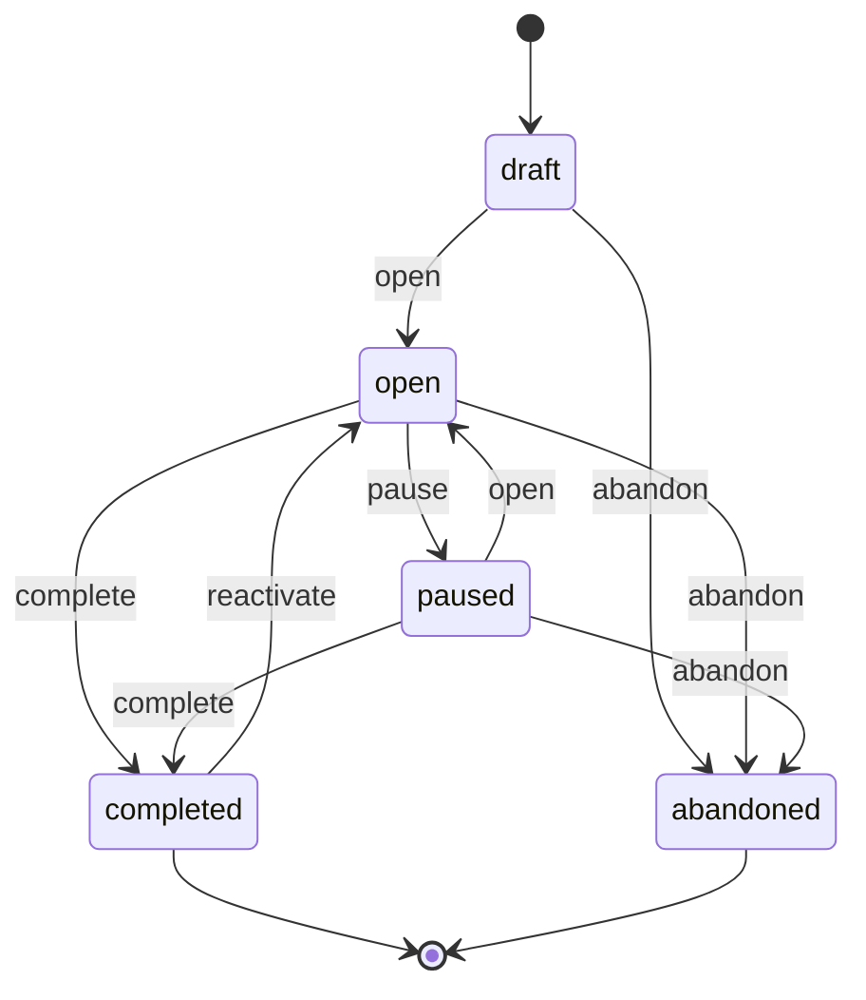
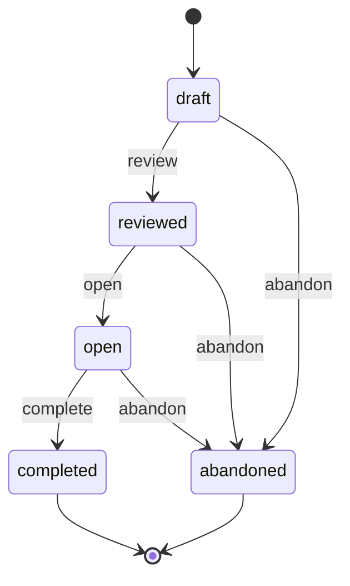

# Crypts and Commits Workflow Reference Guide

## Purpose

### Crypts and Commits

Crypts and Commits ("CAC") preserves a coding assistant's context and work
history across sessions in a managed sourcebook. The developer is the Game
Master: they set context, make decisions, and keep final authority. Assistants
act on the sourcebook only through CAC's MCP server or its `cac` CLI.

### This document

This guide is the source of truth for the sourcebook's domain model, status
lifecycles and guards, cross-type connections, approval gates, and agent
procedure. The packaged agent skills are written against it. Update it in the
same change as any observable change to those rules.

It is paired with the [Tool Reference](tool-reference.md), which owns MCP tool
and CLI command names, arguments, result shapes, errors, response budgets, and
cursor continuation. This guide names tools where a procedure needs them, but
it does not repeat their contracts.

Read this guide through `docs_get("workflow")` / `cac docs get workflow`, and
the reference through `docs_get("tool-reference")` / `cac docs get
tool-reference`. Agents do not need to read either document whole during
routine orientation; see "Priming and the disclosure ladder" for when to pull
them in.

## Domain model at a glance

Seven record types, each Markdown with YAML frontmatter, live in the sourcebook:

| Type | Scope | Lifecycle |
| --- | --- | --- |
| World | Singleton | None |
| Lore | Many | Enabled or disabled |
| Region | Many | None |
| Boss | Project goals | proposed, available, withdrawn, vanquished |
| Campaign | Initiatives; at most one open per checkout | draft, open, paused, completed, abandoned |
| Encounter | Units of work within a campaign | draft, reviewed, open, completed, abandoned |
| Rumor | Backlog notes from anywhere | open, promoted, dismissed |

Every record carries common audit stamps (`created_by`, `created_on`,
`updated_by`, `updated_on`).

### Connections

- World and lore links are reciprocal: `world.assigned_lore` and
  `lore.assigned_to_world`.
- Region and lore links are reciprocal: `region.assigned_lore` and
  `lore.assigned_regions`. One lore entry can serve several regions.
- An encounter's applicable lore is the union of enabled world-assigned lore and
  the enabled lore of every region the encounter is assigned to. It is resolved
  on demand and never stored on the encounter. Lore summaries route; full lore
  bodies govern review.
- A campaign contains its encounters. An encounter's `regions` list is
  one-directional: regions keep no back-reference to encounters.
- An encounter's `depends_on` lists direct prerequisites within the same
  campaign, stored only on the dependent. Reverse dependents are computed when
  needed, for example to block deletion.
- Bosses and campaigns link reciprocally: a campaign lists its `bosses`, and
  each linked boss names its current `campaign`. A boss's `depends_on` lists
  prerequisite bosses.
- A promoted rumor's `boss` names the boss it was linked to, stored only on
  the rumor. Bosses keep no back-reference, and many rumors may share one.

No relationship grants permission to bypass a lifecycle guard.

## World

The world is the project's orientation record, read first. Its body is free
Markdown and it has no status. Its frontmatter holds `name`, `assigned_lore`,
`schema_version`, the branch settings below, and the audit stamps.

### Branch settings

| Attribute | Effective default | Purpose |
| --- | --- | --- |
| `merge_target_branch` | `main` | Where accepted work is integrated |
| `planning_branch` | `planning` | Where goals, rumor triage and archival happen |

New worlds store these defaults. An older world without them reports the
defaults in returned data only: reads and unrelated writes never backfill the
keys or change audit stamps. An explicitly stored value is preserved even when
it is empty or malformed, because the default depends on the key being absent,
not on the value being truthy. If a configured value is unusable, ask the
developer to reconcile it.

Setting a branch name writes only that attribute and the audit stamps. CAC does
not validate it as a Git branch name. A setting does not prove that the branch
exists, and no endpoint behaves differently based on branches. These fields are
additive and do not change the schema version.

### Sourcebook schema versioning

Developer-run bootstrap stamps a new world with the installed schema version. A
world with no `schema_version` is version 1. When bootstrap runs on an existing
sourcebook, it reports whether the stored version is behind or ahead of the
installed library, and never rewrites the stored version.

If the sourcebook is ahead, upgrade the library. If it is behind, use
world-manager and the migration guide (`docs_get("migration-guide")`), which
states the current version and any upgrade steps. There is no migration tool.
Follow the guide's procedure for explicit approval, capture, temporary
guardrail suspension, unconditional restoration and verification before
setting the new `schema_version`. Never assume that bootstrap migrates records,
and never suspend a guardrail without the developer's approval.

## Lore

Lore is a standard, convention or best practice that an encounter is checked
against before it moves from `draft` to `reviewed`. World-assigned lore applies
to every encounter; region-assigned lore applies only to encounters assigned to
that region.

- **Frontmatter:** `name`, `enabled`, `assigned_to_world`, `assigned_regions`,
  `summary`, and the audit stamps. The summary is a routing signal of at most
  500 characters, required with every body write.
- **Body:** the governing rule text. It is what a plan is checked against; the
  summary never substitutes for it.
- **Status:** an `enabled` flag that can be toggled at any time. Disabled lore
  is skipped when resolving applicable lore.

## Region

A region is a documented path in the repository that needs its own
conventions, stack or tooling described (for example "frontend" and "backend"),
and that lore can be scoped to.

- **Frontmatter:** `name`, `path`, `assigned_lore`, `summary` (same rule as
  lore), and the audit stamps. The path is not validated against the
  filesystem, so a region may describe planned work.
- **Body:** free-form documentation of the region.
- **Status:** none. Encounter assignments are recorded only on the encounter.

## Campaign

A campaign is a long-running initiative, similar to an epic, expected to span
many encounters.

- **Frontmatter:** `name`, `status`, the canonical `bosses` list (empty for a
  bossless campaign), `archived` (default false), and the audit stamps.
- **Body:** a free-form description of the tactics. When the campaign is
  completed or abandoned, a dated and attributed postmortem entry is appended
  and the body locks. Explicit reactivation can reopen a completed campaign.

| From | To | Trigger | Guard and effect |
| --- | --- | --- | --- |
| draft | open | open | Only one campaign may be open; the call names the other open campaign. |
| draft | abandoned | abandon | Postmortem message required. |
| open | paused | pause | Fails while any encounter is open. |
| open | completed | complete | Fails while any encounter is open. Postmortem required; locks the body. |
| open | abandoned | abandon | Same open-encounter guard, postmortem and lock. |
| paused | open | open | Same single-open guard. |
| paused | completed | complete | Same as open to completed. |
| paused | abandoned | abandon | Same as open to abandoned. |
| completed | open | reactivate | Unarchived only; nonblank reason and single-open guard. Keeps closing history. |
| abandoned | none | none | Terminal. |

A campaign can be deleted only when its `bosses` list (current or historical
membership) is empty and no boss claims it. Deletion is never a rollback or
renumbering shortcut.

### Archiving

`archived` is a flag, not a status. Archiving never changes the campaign's
status. It moves finished work out of the live campaign and encounter
directories into the sourcebook's archive area, keeping the same layout one
level down.

A campaign can be archived only when its status is completed or abandoned, it
is not already archived, and every one of its encounters is completed or
abandoned. That is broader than the open-encounter guard on complete, pause and
abandon, which lets draft and reviewed encounters through. Archiving a
campaign archives all of its encounters in the same atomic operation; there is
no standalone encounter archive and no unarchive operation.

Archived records stay readable by name and stay in the search index, updated in
place. Lists and search exclude archived records unless asked to include them.
Reading an archived record never restores it. The effects of archiving on
linked bosses are described under "Promotion and campaign coupling".

## Encounter

An encounter is a concrete unit of work within a campaign.

- **Frontmatter:** `name`, `campaign`, `status`, `kind`, `regions`,
  `depends_on`, `archived` (only ever set by archiving the campaign), and the
  audit stamps.
- **Body:** a scripted encounter has four fixed sections: Requirements,
  Rationale, Plan and Verification. An unscripted encounter has only
  Requirements and Rationale. Either kind gains a Log section once a
  transition or message records text. The fixed sections can be replaced only
  while the encounter is in draft; every later change is appended to the Log.

| From | To | Trigger | Guard and effect |
| --- | --- | --- | --- |
| draft | reviewed | review | Message required; at least one region assigned. Performed by an independent reviewer, never the author. Locks the fixed sections. |
| draft | abandoned | abandon | Message required. |
| reviewed | open | open | Optional message. Fails until every direct prerequisite is completed. |
| reviewed | abandoned | abandon | Message required. |
| open | completed | complete | Optional message. |
| open | abandoned | abandon | Message required. |
| completed, abandoned | none | none | Terminal. |

Recording a message without a status change is allowed only while the
encounter is reviewed or open. Region and dependency assignments are allowed
only while it is in draft. A dependency must name a non-abandoned encounter in
the same campaign and cannot create a self-dependency or a cycle. A prerequisite
that is abandoned after assignment remains an unsatisfied blocker until it is
removed or replaced. An encounter cannot be deleted while another encounter
depends on it.

Encounters in a completed or abandoned campaign cannot be changed, but they
remain readable so past work stays inspectable.

### Kind: scripted and unscripted

`kind` is set once, at creation, and never changes.

- **Scripted** (the default) is a plan for future work. The reviewer checks the
  Plan against applicable lore.
- **Unscripted** records work that the developer or agent already did outside
  the plan-first flow, so a later session can recover its intent. Only
  Requirements (what was done) and Rationale (why) apply, and the absence of a
  Plan or Verification is not a defect. The lifecycle, the independent review
  and all three user gates are the same as for scripted work; the reviewer
  checks the recorded Requirements and Rationale in place of a Plan.

## Bosses

A boss is a project goal that can be captured and refined before any campaign
commits to it. Bosses live in the sourcebook's boss collection, and archived
bosses move to the archive area.

- **Frontmatter:** `name`, `summary` (required, at most 500 characters),
  `status`, `archived`, `depends_on` (direct prerequisites by canonical name),
  optional `campaign`, optional roadmap `provenance`, and the audit stamps.
- **Body:** optional headings Goal, Rationale, Success Criteria, Design Notes
  and Open Questions. Body text cannot set frontmatter or bypass guards.

Ordinary capture creates a proposed, unarchived boss with no campaign and no
dependencies.

| From | To | Trigger | Guard |
| --- | --- | --- | --- |
| new | proposed | capture, or roadmap recording of planned or in-progress work | Name unused, live or archived. |
| new | vanquished | roadmap recording of completed work | Unassigned; no synthetic campaign. |
| proposed | available | make available | Prerequisites need not be satisfied yet. |
| proposed, available | withdrawn | withdraw | Must be unassigned. Changes no campaign and no incoming dependency. |
| withdrawn | proposed | reactivate | Must be unarchived and unassigned. |
| available (assigned) | vanquished | linked campaign completes | Only through the campaign; reactivation returns it to available. |

Body, summary and dependency edits require an unarchived, unassigned boss in
proposed or available status, and an edit to an available boss leaves it
available. Once a boss is linked to a campaign, or vanquished, its design is
frozen. Every mutation of an archived boss is rejected. State changes preserve
the design body.

A boss can be archived on its own only when it is unassigned and withdrawn, or
vanquished with valid completed roadmap provenance. Archiving keeps its status,
provenance and body, updates its audit stamps and moves the record. A name
collision fails, and a failed write restores the previous bytes and index
evidence. Retained names, live or archived, cannot be reused. There is no
delete, rename, restore or generic status setter.

### Boss dependencies

Dependencies store canonical names. Adding an edge rejects a self-reference, a
duplicate, an unknown or withdrawn target, malformed storage, an ambiguous
reference and a cycle, all before writing. Existing edges survive withdrawal
and archiving of the prerequisite. Explicit removal can repair a damaged graph,
but only if the whole resulting graph is valid. Dependents are never rewritten
automatically, and availability is never reset.

### Schema and compatibility

Bosses keep schema version 1. Missing storage reads as empty, reads never
write, and storage is created lazily. CAC never infers goals, bulk-converts
records, migrates during bootstrap, or rewrites existing records. Libraries
that predate roadmap adoption must not mutate roadmap records, because they
cannot validate provenance or its completion and archive rules; downgrading
requires developer conversion. Libraries that support only one boss per
campaign cannot operate on multi-boss campaigns (see the migration guide).
Endpoints perform no Git or branch automation.

### Roadmap adoption

A project that already has a roadmap can record its goals with roadmap
recording, which is create-only. Planned and in-progress goals become proposed.
Completed goals become unassigned and vanquished, with no synthetic campaign or
encounter. Ordinary capture still creates only proposed goals.

The recording requires a nonblank source describing the roadmap or evidence,
and a message explaining the capture and, for completed goals, the outcome and
evidence. CAC records an assertion, not proof of Git integration. It does not
fetch, extract or bulk-import anything.

Provenance is immutable. Its progress value is the original snapshot, never
current readiness or ownership, and audit dates mean "recorded now". A
completion date is optional, applies only to completed goals, and stays unknown
when not supplied. Record prerequisites first so that later goals can depend on
them; relations to goals outside CAC stay in prose. A historical outcome does
not have to replay prerequisite readiness, but graph damage still prevents
downstream trust.

Recorded planned or in-progress goals still need explicit approval before they
are made available. References to existing campaigns are informational;
adopting ownership of open legacy campaigns is deferred. Draft-only membership
locks still apply. An externally completed goal satisfies dependencies, even
when archived, and is frozen like any other completed content. Mistakes need
documented developer repair, never direct edits by an assistant, and there is
no undo operation. Failures roll back the affected records while preserving
unrelated drift. Prime still includes only actual active membership.

For example: record delivered `b001` as completed, then planned `b002`
depending on `b001`, then in-progress `b003`. Keep the roadmap's references and
known completion dates. You do not need to import the entire roadmap or invent
execution history.

### Candidate discovery

Candidate discovery explains which goals could be selected for a campaign. It
is read-only and is not proof of integration. Numbered names sort by number,
then by name, and legacy names follow lexically; this order is not business
priority or permission to select.

The pool is every live, unassigned boss in proposed or available status.

- A proposed boss is `not_ready`.
- An available boss is `eligible` only when every direct prerequisite is
  vanquished (an archived completion counts) and the reachable graph is
  intact; otherwise it is `blocked`.
- Every other boss is excluded from the pool. Discovery never changes
  readiness.

Campaign links must resolve, reciprocate and match lifecycle and archive state:
an available boss belongs with a draft, open or paused campaign, and a
vanquished boss with a completed one. Archived defects still affect health.
Unrelated damage does not hide healthy choices, and the counts distinguish an
empty pool from excluded, unready and blocked goals. Defects reachable from a
dependent block it.

### Promotion and campaign coupling

A campaign has zero or more bosses, and a boss has at most one current
campaign. There is no primary boss.

Selection creates a new draft campaign and links it to every selected boss in
one atomic step. Each boss must be eligible, unassigned, unarchived and
available. Selecting a prerequisite together with its incomplete dependent does
not satisfy the dependency. Selection leaves the bosses available but frozen,
and opens no campaign and creates no encounters. A new campaign name must be
unused, live or archived, and unclaimed. The single-goal convenience
(`boss_assign_campaign`) behaves the same way for one boss; a consistent retry
is read-only, even after progress, archiving or group membership, and never
shrinks membership. A retry against a different or released campaign fails.
Initial selection checks full eligibility; retries do not recheck
prerequisites.

While a campaign is in draft, its whole membership can be replaced with a
nonblank reason. Retained members must still reciprocate, and removal releases
only this campaign's links. Membership locks once the campaign leaves draft,
including after reactivation, and body edits can never change links.

Lifecycle effects on bosses:

- **Completion** records the postmortem and vanquishes every linked boss.
- **Abandonment** releases every current link while keeping the historical
  membership list on the campaign.
- **Reactivation** requires an unarchived completed campaign, a nonblank
  reason and no other open campaign. Every linked boss returns to available
  but stays assigned and frozen. The earlier Log and closed encounters remain,
  and recompletion appends new history.
- **Open and pause** never vanquish. Bossless campaigns follow the same
  lifecycle.

Archiving a completed campaign moves its assigned bosses along with its
terminal encounters, preserving status and readable history. Archiving an
abandoned campaign never touches released bosses, whatever has happened to
them since. Rumors are never touched. Current and historical membership lists
and reverse claims protect against deletion. Broken or competing ownership, or
an inconsistent lifecycle state, blocks mutation until it is repaired.

## Rumors

A rumor (`rNNN-slug`) is a backlog note, "we think X should be done", from
anywhere: execution, a review, a customer, the running project. It carries a
summary, a free-text `origin` and an optional body, and can be captured on any
branch. Only `open` rumors can be edited.

- **Promote** (`open` to `promoted`) links the rumor to an existing unassigned
  `proposed` or `available` boss, recorded only on the rumor; the boss is never
  written. Many rumors may share a boss.
- **Dismiss** (`open` to `dismissed`) requires a reason; **reopen** returns
  either to `open` with a message. **Archive** retires a promoted or dismissed
  rumor read-only. There is no delete, and transition messages stay in
  `history`.

Numbers captured on different branches can collide. They are renumbered on the
planning branch; promoted rumors keep their number, because promotion happens
on planning, where numbering is settled. Similar rumors are never merged:
repetition is a signal. Rumors never affect bosses, candidates or campaign
lifecycle, are searchable under their own type, and are not part of prime.

## Explicit user gates

Three points in the encounter lifecycle need the developer's explicit,
real-time approval. Reaching the status before a gate is never consent to cross
it: the agent stops, asks, and waits for an explicit answer every time.

1. **Before spawning the independent reviewer** (the prerequisite for draft to
   reviewed). Drafting is not approval to review. Ask fresh every time,
   including for a re-review after a REJECT or NOT-REVIEWABLE verdict and a
   revised draft. Only on an explicit yes does the agent spawn a fresh reviewer
   subagent: never itself, and never a fork that shares the author's context.
2. **Before opening the encounter** (reviewed to open). This is separate from
   gate 1. A PASS-WITH-NOTES verdict moves the encounter to reviewed without a
   pause of its own, because gate 1 already covered it, but starting execution
   is its own request.
3. **Before marking the encounter complete** (open to completed). After
   Verification passes, the agent confirms with the developer before closing
   it, even when every check is green.

Both `campaign_manager` skill templates
(`templates/skills/claude/campaign_manager/SKILL.md` and
`templates/skills/codex/campaign_manager/SKILL.md`) must state each gate's
stop-and-ask instruction in their own wording, so that an agent following the
skill alone, with no memory of this guide, would still stop and ask. A
cross-reference to this guide is not enough. This holds every time either
template is edited or regenerated, for any reason. An edit that drops, weakens
or fails to carry forward any gate is a defect, caught by checking the
template's current text against this section.

Not separately gated: the draft-to-reviewed transition itself once a
PASS-WITH-NOTES verdict is in hand, campaign transitions, and lore, region and
world edits. Those take effect when the tool is called, subject to the
authorization rules in "Agent planning and campaign workflow".

### Review flow

The reviewer receives only the encounter and campaign names. It primes context
itself, resolves applicable lore, reads each lore body, and checks the Plan (or
an unscripted encounter's Requirements and Rationale) within a bounded reading
surface: the encounter, the applicable lore bodies, the assigned regions'
paths, and files the encounter names. It flags anything outside that surface as
unverified rather than investigating it. It returns findings, one verdict
(PASS-WITH-NOTES, REJECT or NOT-REVIEWABLE) and a proposed review message, and
it runs no mutating operation.

On PASS-WITH-NOTES, the main thread immediately records the reviewer's proposed
message through `encounter_review`, which locks the fixed sections, and then
reports. Later feedback is recorded as a message, never as a re-draft. On
REJECT or NOT-REVIEWABLE, the encounter stays in draft; the agent revises it
and returns to gate 1. An absent Plan or Verification is never by itself
grounds for NOT-REVIEWABLE on an unscripted encounter.

## Codex encounter handoffs

The Codex `campaign-manager` skill adds two conversational reports. They
supplement the encounter record and preserve all three gates. The skill carries
the full operative guidance; this section states what the reports must cover.

Each report stands on its own: the developer should be able to understand the
work or the review outcome and make the next decision without opening the
encounter. Include the encounter's full reference. Scale depth to complexity
and uncertainty, explain why details matter, and avoid a fixed word count,
padding, or pasting the encounter.

**After drafting, before asking to review,** explain the encounter's identity,
kind and draft status; the problem, motivation and intended outcome; scope,
affected areas, main steps and significant tradeoffs; dependencies,
assumptions, risks and unresolved decisions (saying so when there are none);
and the verification approach and success criteria. For unscripted work,
describe what was done, why, the evidence and any follow-up instead of a
future plan. After revising a rejected draft, explain what changed, why it
addresses the findings, and what remains open.

**After every review,** explain the verdict and its coverage and limits, each
material finding with its reasoning and importance (separating blockers,
actionable notes and unverified concerns), the consequences for scope, risk and
readiness, the resulting status and locking, and a reasoned recommendation with
the next approval needed. On PASS-WITH-NOTES, transition first, then report and
ask separately to open. On REJECT or NOT-REVIEWABLE, keep the draft, explain
the blockers, and after revising ask again before launching a fresh reviewer;
revision alone is not a passing review. Never replace or rewrite the
reviewer's recorded message, and keep your own recommendations distinct from
its findings. A recommendation never authorizes a review, an opening or a
completion.

## Priming and the disclosure ladder

world-manager carries the disclosure ladder, the procedure for loading only as
much context as a task needs:

1. **Orient** with `prime_get`, once per session or before other work. It
   returns the full world, world-lore summaries, the region map, the active
   campaign body, and the active bosses with diagnostics. Hydrate truncated
   bodies through the refs it returns. Empty membership is different from a
   named member that is missing or broken.
2. **Focus** on a region when one is in scope: read the region, then the
   summaries of its assigned lore.
3. **Review** with `prime_applicable_lore` for an encounter, then read each
   applicable lore body in full. Only the bodies are authoritative.
4. **Go deeper** only when a procedural or contract question remains. Read
   this guide for a rule, lifecycle, gate or branch procedure, the Tool
   Reference for an argument, result shape, error or budget, the branching
   guide for a worked Git example, and the migration guide for upgrades and
   adoption. `docs_list` shows what is registered.

campaign-manager and world-planner start from step 1 and do not read this
guide or the Tool Reference during routine orientation. Their skills name the
section to consult when a question arises. Most sessions never need step 4.

The search index is a full-text index over sourcebook records, kept current as
records change through CAC. It finds encounter text, but it is not an
allocation inventory or a dependency graph. A stale or missing index needs a
developer rebuild.

## Agent planning and campaign workflow

### Ownership

- **world-manager** owns static context: the world, lore, regions, the
  disclosure ladder and migration routing.
- **world-planner** owns goals: planning, roadmap adoption, readiness,
  dependencies and splitting, triaging integrated rumors (renumbering,
  promotion and dismissal), and planning-side archival.
- **campaign-manager** owns tactical work: selection and registration, draft
  membership, encounters and execution.

Both provider variants of each skill implement this procedure. Invoking a
skill is not blanket permission to publish, push, merge, delete, or message
other people. Use authorization the developer has already given without asking
again. The encounter gates above stay distinct; ordinary goal notes have no
encounter gates.

### Orient and synchronize

Read prime and the effective branch settings. Prime's bosses are the active
campaign's membership, not the whole roadmap. Finish every page of an
inventory, and hydrate the bodies and diagnostics you rely on. Bootstrap and
index rebuild are developer-only.

Before editing goals or selecting them, synchronize accepted merge-target
history onto the planning branch under the project's Git policy. Check the
checkout, branch, uncommitted changes and detached HEAD state, and reconcile any
mismatch without silently switching branches or overwriting work. Refresh
authorized remote refs on a best-effort basis and say when you could not.
Local completion is not integration, and a roadmap's completed status is
supplied evidence, not proof of a CAC merge.

### Allocate numbers

CAC numbers bosses, campaigns, encounters and rumors by convention: core never
allocates. Choose the numeric maximum plus one, padded to three digits below
1000 and continuing at 1000. Never reuse a retained ID, and never infer the
maximum from lexical, time or search order.

- **Bosses:** every page of the boss list including archives, on a
  synchronized planning branch.
- **Campaigns:** every page of the campaign list including archives, plus known
  local and remote campaign branches, including unpublished reservations. A
  matching `c00N-example` and `c00N-example-assignment` pair counts once.
- **Encounters:** every page of the encounter list including archives, within
  the exact campaign.
- **Rumors:** every page of the rumor list including archives, on the current
  branch. Rumors may be numbered on any branch; collisions found after
  integration are renumbered on planning.

Unnumbered legacy names remain valid. Ambiguous shorthand requires the
canonical name.

### Plan goals

Capture and refine goals with the boss operations. Roadmap recording preserves
the original progress and source evidence and truthful audit dates. Planned and
in-progress goals stay proposed until explicitly made available. Explain each
candidate's classification (eligible, blocked or not ready) without treating
order as priority or permission. Scope edits keep an available goal available;
reassess readiness and affected dependents. Split only editable goals, keep the
original identity, and reconcile dependencies explicitly. Never rewrite
dependencies automatically or edit an assigned design.

### Select and register

Write tactics that cover every developer-selected eligible goal and its success
conditions. On the assignment branch (`c00N-example-assignment`, created from
the synchronized merge target), create the draft campaign with its bosses, or
use the single-goal convenience. Confirm the reciprocal links, and inspect any
error and its rollback. Integrate the registration through the project's PR or
direct-merge process before execution. Selection opens nothing and creates no
encounters. A bossless campaign may skip registration and start directly on
its execution branch, with the same allocation checks.

### Execute on the campaign branch

Create or resume the execution branch (`c00N-example`) from the accepted
registration or the merge target; if starting from the assignment branch,
reconcile the accepted registration first. Open the campaign only on its
execution branch and only with explicit approval. Under the recommended
workflow, the merge target and planning branches never have an open campaign,
and paused work stays on its execution branch. These are skill guidance, not
endpoint gates or mandatory CI or hosting rules. Honor custom branch settings.
Draft membership changes need a reason; opening or reopening locks membership.
Boss designs stay frozen.

### Collision checks

Check for logical collisions when creating a campaign or encounter, after
integrating another branch (pull, merge or rebase), and before completion when
preparing implementation for integration; repeat after review fixes. Compare
numeric IDs and names, encounter IDs within the campaign, and reciprocal
ownership of every boss. A clean Git merge does not detect two records with the
same number and different slugs, or competing assignments. Explain any conflict
and coordinate an explicit repair. Never silently renumber, delete, force-push,
reset, or edit managed files directly.

### Complete and reactivate

Complete a campaign only after its goals and encounters are verified, with the
required postmortem and the developer's authorization. Completion vanquishes
every linked goal; abandonment releases every current link while keeping the
historical membership. For review fixes before merging, reactivate with a
reason on the execution branch, keep membership and history, add reviewed
follow-up encounters (completed encounters never reopen), verify, and complete
again. New scope after merging goes back to planning. Integrate terminal
execution records before planning relies on their outcomes. Publishing and
merging need the developer's authorization.

### Reconciliation examples

- **Rejected registration.** Establish whether the registration was integrated
  and inspect the visible assignment and execution branches. Revise it or
  abandon it explicitly, keeping useful notes and the number reservation. Never
  present a rejection as acceptance, and never delete automatically.
- **Accepted draft cancelled before execution.** Abandon the campaign with a
  reason on its execution branch, integrate that cleanup, and synchronize the
  planning branch. Do not release links by hand.
- **Legacy unnumbered open work.** Inspect its encounters and local
  instructions, and agree on a matching execution branch and naming with the
  developer. Finish or abandon open encounters before pausing or closing.
  Preserve history: do not invent a boss, bulk-rename records, or add a new
  endpoint branch gate.
- **Uncertain remote or integration state, or a failed recovery.** Stop and
  reconcile explicitly with the developer.

### Planning handoff

Any skill captures rumors through CAC on whatever branch the work happens,
without expanding the current scope. On the planning branch, world-planner
triages integrated open rumors: it renumbers collisions, promotes a rumor to
a new or existing unassigned boss the developer selects, or dismisses it with
a reason, and archives resolved rumors that are no longer useful. There are
no forced categories, no implicit scope expansion, no edits to assigned
designs, and no deletion. After
synchronizing, world-planner may archive integrated terminal campaigns whose
encounters are all terminal; only their current bosses move, while released
history and rumors stay where they are. Standalone boss archiving follows its
withdrawn or externally completed guards. There is no restore, and assistants
never repair records by editing files.

## Example: an encounter's lifecycle

1. Orient with prime. If no campaign fits the task, world-planner helps capture
   or choose goals; capturing a goal does not assign it.
2. With authorization, campaign-manager selects eligible goals, writes a
   tactical draft, and registers it on `c00N-example-assignment`. After the
   registration is accepted, it switches to `c00N-example` and opens the
   campaign with explicit approval. A bossless campaign skips registration.
3. Draft the encounter (for example `c00N/e00M`) with its sections, regions
   and prerequisites. Unscripted work records only Requirements and Rationale.
4. Ask for approval to review, then spawn a fresh reviewer with only the two
   names. It reads the applicable lore bodies itself.
5. On PASS-WITH-NOTES, record the reviewer's message, which locks the
   sections, and report. On REJECT or NOT-REVIEWABLE, revise and ask again.
6. Ask separately for approval to open. Opening requires every prerequisite to
   be completed.
7. Execute the Plan, logging deviations as messages rather than editing locked
   sections.
8. Run Verification (or confirm an unscripted record's accuracy), then ask the
   developer to confirm completion before completing.
9. When asked, commit the deliverable together with the encounter record.
   Completing an encounter does not authorize completing the campaign, pushing
   or merging.

## Developer-only maintenance

### Bootstrap

`cac bootstrap init` creates the sourcebook and seeds the world, registers the
MCP server, deploys the guardrails, and deploys the agent skills into a
project. Only the developer runs it; it is never exposed over MCP. Deployed
skill files are framework-owned and overwritten on every run. Bootstrap never
rewrites user-owned `CLAUDE.md` or `AGENTS.md` files; adopting new workflow
there takes targeted edits (see the migration guide).

### Search index rebuild

`cac index rebuild` is the only recovery for a missing, stale, legacy or
damaged search index. Only the developer runs it, and it is never exposed over
MCP or run automatically.

### Codex patch guard

The packaged Codex `PreToolUse` hook is registered for `^apply_patch$` only.
It reads the patch's file-operation headers (`Add File`, `Update File`,
`Delete File` and `Move to`) and denies the whole patch if any target path has
a `.sourcebook` component after normalization. Both ends of a move and every
file in a multi-file patch are checked. Added, removed and context lines are
not headers, so ordinary patches may mention sourcebook paths. Shell calls are
not filtered by this hook, and the MCP/CLI-only rule for managed content stays
binding.

The hook handles events with `tool_name: "apply_patch"` and either a string
`tool_input` or an object whose `command` field holds the patch. Headers start
at column zero, with LF or CRLF line endings and unquoted paths. The guard
normalizes dot segments and both slash styles; Windows paths compare components
case-insensitively, and POSIX paths keep case. It does not require a complete
patch envelope, since `apply_patch` validates syntax itself. Invalid JSON,
missing or mistyped fields, unsupported payloads, and text with no recognized
headers produce no decision. This lexical guard is not a filesystem sandbox:
symlink and junction aliases, unusual path aliases, and other tool payload
formats are outside its contract.

Bootstrap replaces the deployed hook script and upgrades recognized legacy
`^(Bash|apply_patch)$` registrations. It keeps exactly one apply_patch-only
framework registration and preserves unrelated hooks (including those sharing
the broad group), settings and recognized customizations. Custom commands or
matchers outside the known registration are left alone and may need developer
review. The developer reviews and trusts the updated hook through `/hooks`,
re-enabling it if it was disabled. Agents never redeploy the hook or change
trust settings.
